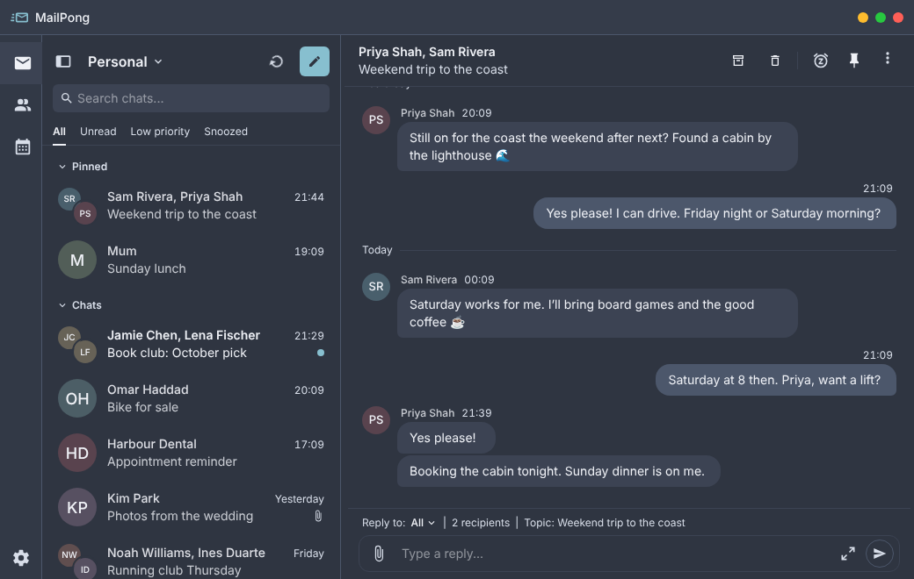

# MailPong

**Email, reimagined as chat.**

MailPong is like a Messenger app for your mailbox: it simplifies your inbox by turning email threads into combined chats. It is a cross-platform desktop email client built with Go, [Wails](https://wails.io) and [Svelte](https://svelte.dev/).

MailPong is alpha software under active development. Expect rough edges, and keep backups of anything important.

## Built on Aerion

MailPong is derived from [Aerion](https://github.com/hkdb/aerion), the open-source email client created by [@hkdb](https://github.com/hkdb). MailPong is independently maintained and is not an official Aerion release; the Aerion project does not endorse or support it.

- **Version numbering** continues from the Aerion code base MailPong derives from. Always read "MailPong 0.4.0" as a MailPong version, not an Aerion version.
- **Separate data.** MailPong uses its own data directories and keyring entries and never reads Aerion's data on its own. To bring an Aerion mailbox across, see [Import from Aerion](docs/user-guide/getting-started/import-from-aerion.md).
- **Upstream releases do not include MailPong's changes.** Report problems with MailPong here, not upstream.

**Legal:** [Disclaimer](DISCLAIMER.md) · [NOTICE](NOTICE) · [Third-Party Notices](THIRD_PARTY_NOTICES.md) · [License](LICENSE) (Apache-2.0)

## Features

- Threads show as chat bubbles, with quoted history and signatures hidden
- A docked reply box at the bottom of each conversation
- Keyboard triage: archive, pin, snooze, and mark unread
- A Low priority split that keeps newsletters and other bulk mail out of the main list
- Sender chats that combine all of one sender's threads into a single conversation (on by default, split per sender)
- Pin, snooze, sender priority, and sender chats are stored on this computer and are not synced to the server
- English interface, with US, UK and Canadian English spellcheck; email content in any language and script

See [Email Management](docs/user-guide/features/email-management.md#chat-mail) for details.

## Installation

There are no published releases yet. Build from source with the [Build Guide](docs/BUILD.md), or follow the [Installation Guide](docs/user-guide/getting-started/installation/index.md) for build-from-source and local Flatpak steps on each platform.

## Documentation

- [User Guide](docs/user-guide/intro.md)
- [Build Guide](docs/BUILD.md)
- [Release process](docs/RELEASE.md)
- [Changelog](CHANGELOG.md)

## Contributing

Please see [CONTRIBUTING.md](CONTRIBUTING.md). Report vulnerabilities according to [SECURITY.md](SECURITY.md).

## License

MailPong is licensed under the Apache License 2.0; see [LICENSE](LICENSE) and [NOTICE](NOTICE).
